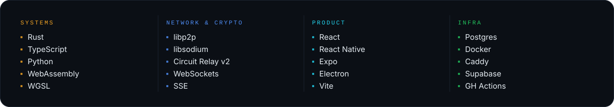
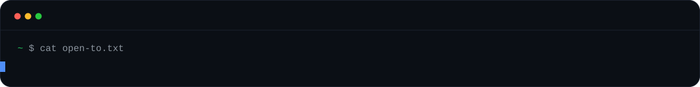

  <a href="https://kant.network"><b>kant.network</b></a>&nbsp;&nbsp;·&nbsp;&nbsp;<a href="#selected-work">Selected work</a>&nbsp;&nbsp;·&nbsp;&nbsp;<a href="#under-the-hood">Under the hood</a>&nbsp;&nbsp;·&nbsp;&nbsp;<a href="#everything-else">Everything else</a>&nbsp;&nbsp;·&nbsp;&nbsp;<a href="mailto:magcecu@gmail.com">Contact</a>

 

 

## Selected work

  
  

  
  

  
  

 

## Under the hood

Click any project to open it.

<b>Kant</b>&nbsp;&nbsp;<code>messaging</code>&nbsp;&nbsp;No servers, no phone numbers, no metadata to hand over

 

**The problem.** Every mainstream messenger has a server that knows who talks to whom, when, and from where. Even with end-to-end encryption, that metadata alone is enough to map someone's life.

**What it does.** Messages go device to device over libp2p. When two peers can't reach each other directly (NAT, carrier networks, firewalls), a circuit relay forwards the traffic. The relay only ever holds ciphertext: it isn't a message store and has nothing to decrypt. Optional multi-hop onion routing with cover traffic hides the routing metadata too.

- **Crypto** &nbsp; X3DH key agreement and the Double Ratchet on libsodium
- **Clients** &nbsp; Linux, Windows, macOS (Apple Silicon and Intel), Android, iOS
- **Relays** &nbsp; Anyone can run one, even from home behind a router they can't configure, through Tailscale Funnel or a tunnel
- **Codebase** &nbsp; TypeScript pnpm monorepo: core, relay, app, desktop, CLI, push proxy, site, admin. About 33k lines
- **Licence** &nbsp; AGPL-3.0 for the messenger, core, relay and clients. A separately licensed enterprise admin layer

[Repository](https://github.com/CecuTheMag/Kant) · [kant.network](https://kant.network) · [How it works](https://kant.network/how-it-works) · [Threat model](https://github.com/CecuTheMag/Kant/tree/main/docs/security)

<b>Swarm</b>&nbsp;&nbsp;<code>distributed systems</code>&nbsp;&nbsp;A school's idle computers, turned into one machine

 

**The problem.** Schools have thousands of computers idle most of the day and every night, and every student carries a phone with a capable GPU. The students and teachers next to them still run out of compute for ML, simulation and rendering.

**What it does.** Open a page or scan a QR code and the device becomes a compute node. The Rust coordinator splits a job into work units and schedules them across devices that join, leave and drop mid-task. Anyone can join, so the coordinator assumes some devices lie: it checks results with redundancy and spot checks before accepting them.

- **Sandbox** &nbsp; Jobs are WebAssembly modules with zero imports: no network, no files, no clock, no randomness. That makes them safe on a stranger's phone and deterministic, which is how wrong answers get caught
- **GPU** &nbsp; WebGPU compute shaders, measured bit-exact against the Rust reference on a Snapdragon 778G+ (Adreno 642L), with a CPU fallback for machines where WebGPU won't start
- **First workload** &nbsp; A school timetable solver, with pinned lessons and scoring in WebAssembly
- **Tested on** &nbsp; Chromium, Firefox and WebKit, including a device dropping its connection mid-unit
- **Codebase** &nbsp; About 20k lines of Rust across 7 crates, plus a TypeScript web console

Private until demo day.

<b>ДефиКарта</b>&nbsp;&nbsp;<code>emergency response</code>&nbsp;&nbsp;Nearest AED, call 112, guided CPR

 

**The problem.** Survival from cardiac arrest falls with every minute before the first shock. Bystanders don't know where the nearest defibrillator is, and most have never done CPR.

**What it does.** Opens straight to the nearest AED that's open right now, puts 112 one tap away, and counts you through hands-only CPR. A dispatcher console pages trained responders nearby, and a coverage map shows the parts of the city no AED reaches in time.

- **Apps** &nbsp; Native iOS and Android (Expo), plus an installable PWA that keeps working offline and never reloads a tab mid-emergency
- **Data** &nbsp; Only real, sourced AEDs, imported from OpenStreetMap and checked against `opening_hours`
- **Core** &nbsp; One shared package for ranking, the incident state machine, the dispatch planner and CPR timing, so every app makes the same call
- **Backend** &nbsp; A local drill server with realtime SSE and simulated responders. A Supabase rollout is planned

[Repository](https://github.com/CecuTheMag/Defikarta)

<b>SchoolSync</b>&nbsp;&nbsp;<code>4th NETIT · 100 pts NOIT</code>&nbsp;&nbsp;Every piece of school equipment, accounted for

 

**The problem.** Schools lend out projectors, laptops, cameras and lab kits on paper, or not at all. Nobody knows what's where, what's broken, or who has it.

**What it does.** Every item gets a QR code. Students request, managers approve, and the system tracks each item through checkout, use and return, emailing everyone at every step. It also tracks condition, repairs, low stock and overdue returns.

- **Multi-tenant** &nbsp; One isolated PostgreSQL schema per school, with district-wide reporting on top
- **Roles** &nbsp; Student, teacher, manager and admin, each seeing only what they should
- **Frontend** &nbsp; React, Vite, Chart.js, Framer Motion, an in-browser QR scanner
- **Backend** &nbsp; Node and Express, Joi validation, Docker deployment
- **Results** &nbsp; 4th place at NETIT. 100 points and selected for NOIT

[Repository](https://github.com/CecuTheMag/SchoolSync)

<b>Open Zagora</b>&nbsp;&nbsp;<code>4th · hackathon</code>&nbsp;&nbsp;A city's budget, readable by anyone

 

**The problem.** Stara Zagora publishes its budget, projects and council votes as PDFs nobody reads.

**What it does.** It parses the municipal documents and turns them into a public dashboard: projects pinned on a map, budget allocation by category, and how the council voted on each decision.

- **Pipeline** &nbsp; PDF upload, text extraction with `pdf-parse`, structured into Postgres
- **Frontend** &nbsp; React, Tailwind, Leaflet maps, Recharts
- **Backend** &nbsp; Express and PostgreSQL, Docker Compose
- **Result** &nbsp; 4th place at a hackathon

<b>Findr</b>&nbsp;&nbsp;<code>AI · B2B</code>&nbsp;&nbsp;A study advisor universities drop into their site

 

**The problem.** A student looking for *"a free master's in renewable energy, taught in English"* gets a hundred tabs and no answer.

**What it does.** A chat agent answers from a catalogue of 2,215 programmes at 230 German universities, then keeps the conversation going until the student knows where to apply. It's sold to universities as a one-tag embed that runs on our domain, is authorised by a connection key and is metered per partner.

- **Retrieval** &nbsp; The catalogue lives in its own Postgres with full-text and trigram indexes, queried through a `search_courses` tool. Free, fast, and inspectable, with web search as the fallback
- **Security** &nbsp; Separate app and admin stacks: different JWT secrets, databases and CORS origins. No credential crosses between them
- **Stack** &nbsp; Node, Postgres, React, nginx, Docker Compose

Private.

 

## Everything else

<table>
<tr>
<td width="50%" valign="top">

**[Buttonwood](https://github.com/CecuTheMag/Buttonwood)** &nbsp;<code>TypeScript</code> 
Self-hosted Telegram trading companion for Solana. It paper-trades on live Jupiter quotes, follows whale wallets after token safety checks, and scores every strategy by its actual results.

</td>
<td width="50%" valign="top">

**advDash** &nbsp;<code>Python</code> <code>Docker</code> 
Fleet control for browser automation. One container per account, each with a real, visible Chromium behind its own proxy, plus a dashboard to create, watch and dispatch them.

</td>
</tr>
<tr>
<td valign="top">

**Техничар** &nbsp;<code>TypeScript</code> 
A verified peer-to-peer hardware marketplace for Bulgaria: components, networking gear and homelab kit, with a hardware scanner wired end to end. Bilingual.

</td>
<td valign="top">

**[Doug](https://github.com/CecuTheMag/DougWeb)** &nbsp;<code>Python</code> <code>TypeScript</code> 
A low-latency AI executive assistant that answers and screens your incoming calls. The web interface is open source.

</td>
</tr>
<tr>
<td valign="top">

**[Cardinal](https://github.com/CecuTheMag/Cardinal)** &nbsp;<code>Python</code> 
An all-in-one network diagnostics toolkit in a terminal UI: port scans, DNS, traceroute, TLS checks, SSH, FTP, mail and database connectivity.

</td>
<td valign="top">

**[DSM](https://github.com/CecuTheMag/DSM-Discord-Bot)** &nbsp;<code>discord.js</code> <code>MongoDB</code> 
A modular Discord server manager: moderation with role-hierarchy checks, tickets with HTML transcripts, and verification.

</td>
</tr>
<tr>
<td valign="top">

**[GreenEye](https://github.com/CecuTheMag/GreenEye)** &nbsp;<code>Python</code> 
A lightweight file-activity monitor and antivirus for test machines, with webcam-use detection. My first security project, from 2023.

</td>
<td valign="top">

**Placet** &nbsp;<code>agency</code> 
The two-person agency I co-run. We get suspended Google listings reinstated (paid only once they're back) and review codebases before launch.

</td>
</tr>
</table>

 

## Stack

 

<a href="mailto:magcecu@gmail.com">magcecu@gmail.com</a>&nbsp;&nbsp;·&nbsp;&nbsp;<a href="https://kant.network">kant.network</a>

