  <a href="https://kant.network"><b>kant.network</b></a>&nbsp;&nbsp;·&nbsp;&nbsp;<a href="#selected-work">Selected work</a>&nbsp;&nbsp;·&nbsp;&nbsp;<a href="#under-the-hood">Under the hood</a>&nbsp;&nbsp;·&nbsp;&nbsp;<a href="#everything-else">Everything else</a>&nbsp;&nbsp;·&nbsp;&nbsp;<a href="mailto:magcecu@gmail.com">Contact</a>

 

 

## Selected work

Eight products, from cryptographic protocols to a trading desk. Click a card to open it.

  
  

  
  

  
  

  
  

 

## Under the hood

The engineering behind each card. Click any project to expand it.

<b>Kant</b>&nbsp;&nbsp;<code>messaging</code>&nbsp;&nbsp;No servers, no phone numbers, no metadata to hand over

 

**The problem.** Every mainstream messenger has a server that knows who talks to whom, when, and from where. Even with end-to-end encryption, that metadata alone is enough to map someone's life.

**What it does.** Messages go device to device over libp2p. When two peers can't reach each other directly (NAT, carrier networks, firewalls), a circuit relay forwards the traffic. The relay only ever holds ciphertext: it isn't a message store and has nothing to decrypt. Optional multi-hop onion routing with cover traffic hides the routing metadata too.

- **Crypto** &nbsp; X3DH key agreement and the Double Ratchet on libsodium
- **Clients** &nbsp; Linux, Windows, macOS (Apple Silicon and Intel), Android, iOS
- **Relays** &nbsp; Anyone can run one, even from home behind a router they can't configure, through Tailscale Funnel or a tunnel
- **Codebase** &nbsp; TypeScript pnpm monorepo: core, relay, app, desktop, CLI, push proxy, site, admin. About 33k lines
- **Licence** &nbsp; AGPL-3.0 for the messenger, core, relay and clients. A separately licensed enterprise admin layer

[Repository](https://github.com/CecuTheMag/Kant) · [kant.network](https://kant.network) · [How it works](https://kant.network/how-it-works) · [Threat model](https://github.com/CecuTheMag/Kant/tree/main/docs/security)

<b>Swarm</b>&nbsp;&nbsp;<code>distributed systems</code>&nbsp;&nbsp;A school's idle computers, turned into one machine

 

**The problem.** Schools have thousands of computers idle most of the day and every night, and every student carries a phone with a capable GPU. The students and teachers next to them still run out of compute for ML, simulation and rendering.

**What it does.** Open a page or scan a QR code and the device becomes a compute node. The Rust coordinator splits a job into work units and schedules them across devices that join, leave and drop mid-task. Anyone can join, so the coordinator assumes some devices lie: it checks results with redundancy and spot checks before accepting them.

- **Sandbox** &nbsp; Jobs are WebAssembly modules with zero imports: no network, no files, no clock, no randomness. That makes them safe on a stranger's phone and deterministic, which is how wrong answers get caught
- **GPU** &nbsp; WebGPU compute shaders, measured bit-exact against the Rust reference on a Snapdragon 778G+ (Adreno 642L), with a CPU fallback for machines where WebGPU won't start
- **First workload** &nbsp; A school timetable solver, with pinned lessons and scoring in WebAssembly
- **Tested on** &nbsp; Chromium, Firefox and WebKit, including a device dropping its connection mid-unit
- **Codebase** &nbsp; About 20k lines of Rust across 7 crates, plus a TypeScript web console

Private until demo day.

<b>ДефиКарта</b>&nbsp;&nbsp;<code>emergency response</code>&nbsp;&nbsp;Nearest AED, call 112, guided CPR

 

**The problem.** Survival from cardiac arrest falls with every minute before the first shock. Bystanders don't know where the nearest defibrillator is, and most have never done CPR.

**What it does.** Opens straight to the nearest AED that's open right now, puts 112 one tap away, and counts you through hands-only CPR. A dispatcher console pages trained responders nearby, and a coverage map shows the parts of the city no AED reaches in time.

- **Apps** &nbsp; Native iOS and Android (Expo), plus an installable PWA that keeps working offline and never reloads a tab mid-emergency
- **Data** &nbsp; Only real, sourced AEDs, imported from OpenStreetMap and checked against `opening_hours`
- **Core** &nbsp; One shared package for ranking, the incident state machine, the dispatch planner and CPR timing, so every app makes the same call
- **Backend** &nbsp; A local drill server with realtime SSE and simulated responders. A Supabase rollout is planned

[Repository](https://github.com/CecuTheMag/Defikarta)

<b>SchoolSync</b>&nbsp;&nbsp;<code>4th NETIT · 100 pts NOIT</code>&nbsp;&nbsp;Every piece of school equipment, accounted for

 

**The problem.** Schools lend out projectors, laptops, cameras and lab kits on paper, or not at all. Nobody knows what's where, what's broken, or who has it.

**What it does.** Every item gets a QR code. Students request, managers approve, and the system tracks each item through checkout, use and return, emailing everyone at every step. It also tracks condition, repairs, low stock and overdue returns.

- **Multi-tenant** &nbsp; One isolated PostgreSQL schema per school, with district-wide reporting on top
- **Roles** &nbsp; Student, teacher, manager and admin, each seeing only what they should
- **Frontend** &nbsp; React, Vite, Chart.js, Framer Motion, an in-browser QR scanner
- **Backend** &nbsp; Node and Express, Joi validation, Docker deployment
- **Results** &nbsp; 4th place at NETIT. 100 points and selected for NOIT

[Repository](https://github.com/CecuTheMag/SchoolSync)

<b>Open Zagora</b>&nbsp;&nbsp;<code>4th · hackathon</code>&nbsp;&nbsp;A city's budget, readable by anyone

 

**The problem.** Stara Zagora publishes its budget, projects and council votes as PDFs nobody reads.

**What it does.** It parses the municipal documents and turns them into a public dashboard: projects pinned on a map, budget allocation by category, and how the council voted on each decision.

- **Pipeline** &nbsp; PDF upload, text extraction with `pdf-parse`, structured into Postgres
- **Frontend** &nbsp; React, Tailwind, Leaflet maps, Recharts
- **Backend** &nbsp; Express and PostgreSQL, Docker Compose
- **Result** &nbsp; 4th place at a hackathon

<b>advDash</b>&nbsp;&nbsp;<code>infrastructure</code>&nbsp;&nbsp;A fleet of real browsers, run from one dashboard

 

**The problem.** Browser automation across many accounts usually means a pile of scripts, one shared browser profile, and no way to see what's happening on screen.

**What it does.** Each account gets its own container: a real, visible Chromium on a virtual display, behind its own proxy, with a persistent profile. The dashboard creates them, dispatches jobs to them, streams their logs and shows any browser live over noVNC. When a login asks for a 2FA code, you click in and type it yourself. Your automation code goes in one folder and is called through a single function, `run(ctx)`. Accounts, credentials, proxies, containers, lifecycle, logs and job history are all handled for you.

- **Orchestrator** &nbsp; FastAPI, SQLite and the Docker SDK. It owns the fleet through `docker.sock` and talks to the dashboard over HTTP and one websocket
- **Sessions** &nbsp; Import fifty from a single paste. Start, stop, recreate or wipe in bulk, and move an account to another host as an encrypted bundle
- **Proxies** &nbsp; Paste them in any format, test them for real, assign them, and watch them: background health checks, auto-disable, and sticky-IP drift detection
- **Jobs** &nbsp; Every dispatch is kept with its parameters, return value and traceback. Schedules sit on the same board
- **Profiles** &nbsp; Generated once from a stored seed and rebuilt exactly the same on every restart, so nothing changes under a running account
- **Operations** &nbsp; Operator accounts, backups, host capacity and job outcomes, a `⌘K` command palette, and a fully keyboard-driven UI
- **Dev loop** &nbsp; The code folder is bind-mounted, so editing a file and hitting reload replaces a full image rebuild
- **Codebase** &nbsp; About 29k lines of Python, tests included

Private.

<b>Buttonwood</b>&nbsp;&nbsp;<code>trading systems</code>&nbsp;&nbsp;A Solana trading desk that has to prove itself first

 

**The problem.** Most crypto bots promise profit and show you nothing. Buttonwood works the other way round: prove it on paper, measure it honestly, and only then talk about real money.

**What it does.** It runs on your own server and talks only to you, on Telegram. It watches your Phantom wallet, paper-trades a $1,000 account on live Jupiter quotes with network fees included, finds and copies whale wallets that show a real edge, and compares every strategy with simply holding SOL.

- **Whale autopilot** &nbsp; Rebuilds each candidate wallet's recent round trips and follows only those with a real win rate and copyable hold times. It drops idle whales, auto-pauses losing ones, and measures what following costs: seconds behind, and how much worse the price was
- **Token safety** &nbsp; Checks liquidity, holders, age, mint and freeze authority and holder concentration, plus a buy-then-sell quote that catches honeypots, before every copied buy
- **Strategy lab** &nbsp; Trend following, grid, rebalancing, DCA and take-profit/stop-loss, each in its own budget sleeve. A backtester replays months of history using the same code that trades live, and a weekly tournament moves capital toward what's working
- **Risk manager** &nbsp; Every order from every source passes through it: max size, concentration, a daily loss limit, buys per hour, and a quote sanity check. A `/stop` kill switch survives restarts, and sells are never blocked
- **Wallets** &nbsp; Two-wallet model: Phantom stays the vault. The bot's encrypted wallet can withdraw only back to your Phantom address
- **Always on** &nbsp; Runs under systemd. After any downtime it reports what it missed, and it buys a missed DCA order once, not N times. A health monitor flags failing jobs
- **Readiness** &nbsp; `/readiness` is a go-live checklist the paper record has to pass before real money is even discussed

[Repository](https://github.com/CecuTheMag/Buttonwood) · Paper trading only. Not financial advice.

<b>Doug</b>&nbsp;&nbsp;<code>voice AI</code>&nbsp;&nbsp;An AI that answers your phone, so only the right calls reach you

 

**The problem.** Most calls to a busy person are spam, sales, or something a message would have covered.

**What it does.** Your carrier forwards calls to Doug. It greets the caller, finds out who they are and what they want in natural conversation, and checks your calendar and rules. Then it puts them through to you live, takes a message, or ends the call. You get a summary the moment it hangs up.

- **Pipeline** &nbsp; Twilio Media Streams, Deepgram `nova-2-phonecall` streaming speech-to-text, a fast LLM, and ElevenLabs Flash
- **Zero transcoding** &nbsp; 8 kHz μ-law end to end. Every stage speaks it natively, which saves roughly 60–100 ms per round trip
- **Latency budget** &nbsp; Endpointing 300 ms, STT 100, first LLM token 250, TTS 150: about 800 ms to the first word. Speech starts sentence by sentence, before the model finishes
- **Barge-in** &nbsp; Voice-activity events let the caller interrupt Doug mid-sentence
- **Rules first** &nbsp; VIP numbers go straight through and blocked numbers are rejected before any AI runs
- **Tools** &nbsp; `transfer_call` (a live SIP handoff to your phone), `take_message`, `end_call`
- **Multi-tenant** &nbsp; Personal and business personas, picked from the number that was dialled
- **Tests** &nbsp; 44, none of which need API keys or the network

[Website source](https://github.com/CecuTheMag/DougWeb)

 

## Everything else

<table>
<tr>
<td width="50%" valign="top">

**Findr** &nbsp;<code>LLM agents</code> <code>Postgres</code> 
An AI study advisor that universities embed with one tag. It answers from 2,215 programmes at 230 German universities, held in its own indexed Postgres.

</td>
<td width="50%" valign="top">

**Техничар** &nbsp;<code>TypeScript</code> 
A verified peer-to-peer hardware marketplace for Bulgaria: components, networking gear and homelab kit, with a hardware scanner wired end to end. Bilingual.

</td>
</tr>
<tr>
<td valign="top">

**[Cardinal](https://github.com/CecuTheMag/Cardinal)** &nbsp;<code>Python</code> 
An all-in-one network diagnostics toolkit in a terminal UI: port scans, DNS, traceroute, TLS checks, SSH, FTP, mail and database connectivity.

</td>
<td valign="top">

**[DSM](https://github.com/CecuTheMag/DSM-Discord-Bot)** &nbsp;<code>discord.js</code> <code>MongoDB</code> 
A modular Discord server manager: moderation with role-hierarchy checks, tickets with HTML transcripts, and verification.

</td>
</tr>
<tr>
<td valign="top">

**[GreenEye](https://github.com/CecuTheMag/GreenEye)** &nbsp;<code>Python</code> 
A lightweight file-activity monitor and antivirus for test machines, with webcam-use detection. My first security project, from 2023.

</td>
<td valign="top">

**Placet** &nbsp;<code>agency</code> 
The two-person agency I co-run. We get suspended Google listings reinstated (paid only once they're back) and review codebases before launch.

</td>
</tr>
</table>

 

## Stack

 

<a href="mailto:magcecu@gmail.com">magcecu@gmail.com</a>&nbsp;&nbsp;·&nbsp;&nbsp;<a href="https://kant.network">kant.network</a>

